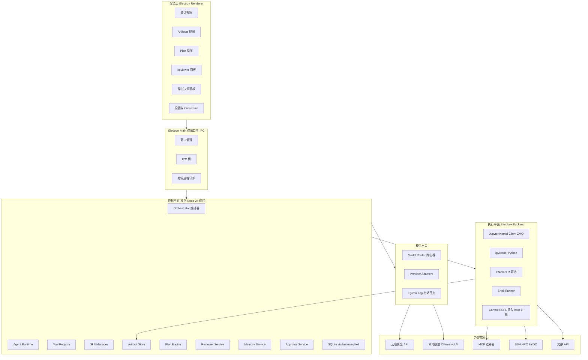

# L-science 平台设计文档

## Overview

L-science 是一个运行在 Windows 上的**本地优先 AI 科研工作台**，面向以论文产出为终点的科研工作流。它对标 Anthropic 的 Claude Science（本设计基于对其 `linux-x64` 单文件可执行程序的逆向分析），并在核心维度上做出实质超越：**多模型能力路由**。

Claude Science 只能调用 Anthropic 自家模型。L-science 把模型抽象为带能力向量的可替换资源，按任务画像、成本与延迟预算动态选择最合适的模型，并支持失败降级、多模型交叉校验（committee）与廉价模型前置分流（escalation）。

### 范围变更记录

| 日期 | 变更 |
| --- | --- |
| 初版 | 含匿名化/脱敏引擎（检测器栈、Entity Vault、假名化、Leak Canary、哈希链审计、数据分级强制约束） |
| 本版 | **匿名化与脱敏整条线已取消**。保留供应商策略标签（`trainingUse` / `zdr` / `local`）作为路由的可选过滤条件，以及一条普通出站日志（用于成本核算与排障）。<br>**后果（知情取舍）**：未发表手稿与受试者数据与普通文本走同一条出网路径，平台层面无任何拦截。 |
| 本版 | AD-1 与 AD-2 的技术前提经实测推翻，两项决策已重写（见下） |

### 与 Claude Science 的对标基线

逆向分析确证的 Claude Science 核心机制（L-science 全部对标实现）：

| 机制 | Claude Science 实现 | L-science 对应 |
| --- | --- | --- |
| 执行运行时 | `bash` / `python`（持久 kernel）/ `r`（持久 session）/ `repl`（控制面 stdlib-only kernel），均支持 `background: true` | 同构四运行时。`python` / `r` 走标准 Jupyter 内核协议；`bash` 在 Windows 上映射为 PowerShell，WSL2 可用时提供真 bash |
| 控制面 API | `host.compute` / `host.frames` / `host.query` / `host.mcp` / `host.agents` / `host.skills` / `host.delegate` / `host.stop_child` / `host.send_message` / `host.artifacts` / `host.findings` | 同名同义的 `host` 对象，额外增加 `host.models` / `host.refs` / `host.claims` |
| Artifact | 内容寻址存储 + 版本谱系，`{{artifact:VERSION_ID}}` 执行期解析为物理路径，代码血缘自动抽取，删除走用户批准卡片 | 同构，并强制要求图表 artifact 绑定生成代码与输入版本 |
| Reviewer | 后台独立审查智能体，findings 分 WARN/FAIL，仅 FAIL 打断主 agent，`mark_addressed` 自报后由下一轮复核 | 同构，且 Reviewer 强制使用与主 agent **不同厂商**的模型以消除同源盲区 |
| 编排 | 协调 agent → `generate_plan`（`phases[].delegations[]`）→ 子 agent 扇出 | 同构 |
| 技能 | 60+ 按需加载技能，`search_skills` 发现，BYOC provider 用 `provider.py` + `provider.json` | 同构技能协议，内置目录换为睡眠/生理信号/神经科学 + 通用论文写作 |
| 安全边界 | host 路径授权（`request_host_access`，ro/rw）、域名白名单 + `egress_domains`、受保护路径黑名单、内容安全拒答视为安全边界 | 同构 |
| 环境管理 | conda 托管环境 + 注册用户 venv（`--system-site-packages` 叠加 editable） | 同构，复用本机 `E:\anaconda` |

### 设计目标

- **本地优先**：所有状态（会话、artifact、审计日志）落在本机，无云端后端，无遥测。
- **零编译安装**：本机无 C/C++ 工具链（无 MSVC，`Windows Kits\10\Include` 为空），所有原生依赖必须提供 prebuilt 二进制。
- **诚实降级**：强隔离能力（网络命名空间、容器）在当前环境不可得时，明确告知用户实际保护强度，不伪装安全。
- **可复现可审计**：任何结论都能回溯到产生它的代码、数据版本与模型调用。

### 非目标（v1）

- 匿名化 / 脱敏 / 数据分级强制约束（已取消）
- 多用户 / 团队协作 / 服务端部署
- 移动端或 Web 托管形态
- 自研模型训练或微调
- 湿实验设备控制

## Architecture

### 进程模型



### 关键架构决策

> 下列 AD-1 与 AD-2 的技术前提均已在本机实测验证，不是推测。实测结论记录在「环境实测结论」一节。

**AD-1：Electron 外壳 + 独立 Node 后端进程；持久化用 better-sqlite3**

Electron 只负责窗口、菜单与 IPC 桥；控制平面跑在一个由系统 Node 24 启动的独立子进程里。持久化用 `better-sqlite3` 13.x。

理由（已修订）：初版设计认为本机无 MSVC 会导致 `better-sqlite3` 编译失败，因此必须改用 Node 内置的 `node:sqlite`。**实测推翻了这一点**——`better-sqlite3` 13.0.2 通过 Node-API 发布 prebuilt 二进制（`prebuilds/win32-x64.node`，按平台而非按 ABI 划分），安装过程零编译，在 Node 24 与 Electron 中都能直接加载，永不需要 rebuild。它比 `node:sqlite` 更优的地方：API 稳定（`node:sqlite` 在 Node 24 仍标记 ExperimentalWarning），且内置 SQLite 版本更新（3.53.4 对 3.50.4）。

进程拆分本身仍然保留，理由改为：UI 崩溃不影响正在运行的长任务；后端可独立重启；未来换 Tauri 外壳时后端零改动；内核与模型调用的资源占用与渲染进程隔离。

**AD-2：直接使用标准 Jupyter 内核协议，不自研内核协议**

`python` 与 `r` 工具背后是标准 Jupyter 内核（`ipykernel` / `IRkernel`），控制平面实现 Jupyter 消息协议客户端（5 个 ZMQ 通道：shell / iopub / stdin / control / heartbeat，HMAC-SHA256 消息签名）。

理由（已修订）：初版设计认为 `zeromq` npm 包需要原生编译因而不可用，故计划自研 JSONL over stdio 协议。**实测推翻了这一点**——`zeromq@6` 同样提供 prebuilt 二进制（`build/win32/x64/node/msvc-115-Release/addon.node`），在 Node 24（ABI 137）上加载成功，libzmq 4.3.5。

用标准协议的收益远大于自研：

- **富输出免费**：`display_data` / `execute_result` / matplotlib inline / DataFrame HTML 表格，全部是协议原生能力
- **R 支持几乎免费**：装 `IRkernel` 即得，不需要为 R 单独写一套宿主
- **标准中断**：control 通道的 `interrupt_request`，不需要在 Windows 上折腾 `GenerateConsoleCtrlEvent`
- **补全与 introspection**：`complete_request` / `inspect_request` 直接可用，为编辑器体验留了口子
- **生态可插拔**：任何符合 Jupyter 规范的内核（Julia、Stata、MATLAB）都能作为新语言工具接入
- **Python 侧零代码**：直接用上游 `ipykernel`，不维护自研宿主

代价是需要实现约 500-700 行的协议客户端（消息分帧、HMAC 签名、通道路由、心跳）。这是一次性成本，且协议有完整公开规范。

**AD-3：沙箱后端可插拔，v1 用用户态隔离并诚实标注强度**

定义统一的 `SandboxBackend` 接口，提供三种实现：

| 后端 | 隔离强度 | 本机可用性 | 网络出口管控 |
| --- | --- | --- | --- |
| `native`（v1 默认） | 弱：Job Object 资源限额 + 工作目录约束 + 工具层路径白名单 + 代理强制 | 立即可用 | 代理级（可被绕过） |
| `wsl2` | 强：独立内核 + 网络命名空间 + 文件系统边界 | 需 `wsl --install -d` 装发行版（管理员 + 重启） | 硬性 |
| `docker` | 强：容器 + 自定义网络 | 需启动 Docker Desktop 重建 WSL 后端 | 硬性 |

理由：Windows Sandbox 与 Containers 可选功能均已禁用，启用需管理员权限 + 重启，当前会话非管理员。因此 v1 必须能在纯用户态跑起来，同时把升级路径留好。UI 持续显示当前隔离强度徽章。

`native` 后端的具体手段：Job Object 施加内存与 CPU 上限并在父进程退出时终止全部子进程（`JOB_OBJECT_LIMIT_KILL_ON_JOB_CLOSE`）；工作目录限定在项目 workspace；路径访问在工具层用规范化后的白名单前缀校验（拒绝 `..`、符号链接逃逸、UNC 路径、备用数据流）；网络出口通过注入 `HTTP_PROXY` / `HTTPS_PROXY` / `NO_PROXY` 强制经过本地转发代理，代理按域名白名单放行。

`native` 后端的已知缺口（必须在 UI 与文档中明示）：内核内的代码可以直接建 socket 绕过代理；Windows 防火墙规则需管理员权限，v1 不做。这是 `wsl2` 后端存在的理由。

**AD-4：Reviewer 强制异厂商**

Reviewer 使用的模型必须与被审查内容的生成模型来自不同 provider（若只有一家可用则明确降级告警）。

理由：同一模型家族的系统性偏差与幻觉模式高度相关，同源自审等于让同一个盲区审自己。这也是多模型路由带来的独有能力——Claude Science 结构上做不到。

**AD-5：Claim Ledger 作为防幻觉的一等公民**

手稿中每一条可核查断言都在数据库里有一条记录，绑定到具体证据（artifact 版本 / DOI / 分析单元）。无证据断言与证据-结论不符由 Reviewer 强制检查。

理由：论文场景下 AI 的最大风险不是写得不好，而是自信地编造。Claude Science 有 artifact 血缘但没有断言级证据绑定，这是 L-science 的原创补强。

### 环境实测结论

以下结论由本机实测得出，是 AD-1 / AD-2 的事实依据：

| 项 | 结论 |
| --- | --- |
| Node | 24.11.1，ABI 137，`node:sqlite` 可用但带 ExperimentalWarning（SQLite 3.50.4） |
| `better-sqlite3` 13.0.2 | 安装零编译，Node-API prebuilt（`prebuilds/win32-x64.node`），加载成功，SQLite 3.53.4 |
| `zeromq` 6 | 安装零编译，prebuilt（`build/win32/x64/node/msvc-115-Release/addon.node`），加载成功，libzmq 4.3.5 |
| C/C++ 工具链 | 完全缺失（无 MSVC、`Windows Kits\10\Include` 为空），因此「所有原生依赖必须 prebuilt」是硬约束 |
| **Jupyter 协议端到端** | 已用真实 `ipykernel` 7.3.0 跑通全链路：HMAC 握手（`kernel_info_reply`，协议 5.3）、stdout 捕获、DataFrame 的 `text/html` 富输出、跨 cell 状态持久、matplotlib inline `image/png`、`ZeroDivisionError` 结构化异常。脚本见 `scripts/verify-kernel.mjs`（`npm run verify:kernel`） |
| Python | conda base 3.13.9（`E:\anaconda`），`uv` 0.11.16，用户既有研究环境 `nidra` / `physioex` / `usleep`（不动） |
| 托管环境 `lsci` | 平台自用环境，落在 `C:\Users\28717\.conda\envs\lsci`（conda `envs_dirs` 首选用户目录，非管理员会话下的正常行为），Python 3.13.14 |
| R | 未安装（`r` 工具做成运行时可选） |
| WSL2 | 内核 2.7.3.0 就绪，默认版本 2，**零发行版** |
| Docker | Desktop 4.72.0 已装，**daemon 未运行** |
| Electron | 43.2.0 可用；但 `npm install` 期间它的 postinstall 未生效（包目录缺 `dist/electron.exe` 与 `path.txt`），需手动跑 `install.js`。已用 `scripts/postinstall.mjs` 幂等兜住 |
| TypeScript | 7.0.2（原生 Go 编译器，按平台分发 prebuilt 二进制）。`tsc --build` 的项目引用工作正常；但 `rewriteRelativeImportExtensions` **接受选项却不生效**，产物里会留下运行时无法解析的 `./x.ts`。因此后端包的相对导入统一写 `.js` 后缀 |
| GPU | RTX 5080 Laptop 16GB，驱动侧 CUDA 13.3，本机 Toolkit 仅 11.8（sm_120 需 cu12x+ 预编译 wheel） |
| 网络 | npmjs.org 可达约 355ms，npmmirror.com 约 82ms；pypi.org 可达 |
| 权限 | 当前会话**非管理员**；Windows Sandbox 与 Containers 功能已禁用 |

托管环境的包管理有一条必须遵守的约束：**只用 uv/pip，conda 仅提供解释器**。实测中用 conda 装 `pyedflib` 时它把 numpy 顺带升到 2.5，而 numba（yasa 的依赖）要求 numpy ≤ 2.4，整个领域栈随即导入失败。现行版本组合为 numpy 2.4.6 / pandas 2.3.3（yasa 与 neurokit2 都要求 pandas < 3）。`scripts/doctor.mjs` 专门检查 numba 与 numpy 的兼容性，因为这一对是混装时最先炸的。

### 数据目录布局

```
%LOCALAPPDATA%\L-science\
  config\
    settings.json              全局设置
    providers.json             供应商与模型注册表
    domain-allowlist.json      网络域名白名单
  credentials\
    vault.bin                  DPAPI 保护的 API 凭据库
  projects\<projectId>\
    project.db                 SQLite：会话、计划、findings、引用、断言
    blobs\<sha256[0:2]>\<sha256>   内容寻址 artifact 二进制
    workspace\                 内核工作目录（会话级子目录）
    logs\egress.jsonl          出站日志（成本核算与排障）
  runtime\
    kernels\                   内核连接文件与运行态
    envs\                      L-science 托管的 conda 环境
  skills\
    builtin\<slug>\            内置技能
    user\<slug>\               用户技能
  logs\
```

## Components and Interfaces

### 1. 控制平面 Orchestrator

编排器是唯一有权发起模型调用与工具调用的组件。它维护会话状态机：

```
idle → planning → executing → reviewing → idle
                ↕ awaiting_approval
                ↕ awaiting_user_input
                ↕ background_pending
```

关键契约：

```typescript
interface Orchestrator {
  startTurn(conversationId: string, userMessage: UserMessage): AsyncIterable<TurnEvent>;
  interrupt(conversationId: string): Promise<void>;
  // 后台任务完成后由此注入结果，对应 Claude Science 的 wait_for_notification
  deliverNotification(conversationId: string, note: Notification): Promise<void>;
}

type TurnEvent =
  | { kind: 'text.delta'; text: string }
  | { kind: 'thinking.delta'; text: string }
  | { kind: 'tool.start'; callId: string; tool: string; input: unknown }
  | { kind: 'tool.output'; callId: string; output: ToolOutput }
  | { kind: 'routing.decision'; decision: RoutingDecision }
  | { kind: 'approval.request'; approval: ApprovalRequest }
  | { kind: 'finding.raised'; finding: Finding }
  | { kind: 'artifact.saved'; artifact: ArtifactVersionRef }
  | { kind: 'turn.end'; usage: Usage };
```

### 2. Tool Registry 与工具面

对标 Claude Science 的工具集，逐一实现：

| 工具 | 职责 | 与 Claude Science 的差异 |
| --- | --- | --- |
| `bash` | 执行 shell 命令，无状态，支持 `background` | Windows 上默认 PowerShell；WSL2 可用时可选 `shell:'bash'` |
| `python` | 持久 Python 内核，状态跨调用保留 | 走标准 Jupyter 协议（`ipykernel`） |
| `r` | 持久 R 会话 | 走标准 Jupyter 协议（`IRkernel`）；运行时探测，R 未安装时不注册该工具并引导安装 |
| `repl` | 控制面 stdlib-only 内核，注入 `host` 全局 | 同构，`host` 表面更大 |
| `save_artifacts` | 工作区文件提升为 artifact，抽取代码血缘 | 图像类强制要求可复现血缘 |
| `read_file` | 按 artifact version_id 或绝对路径读取；PDF 按页读 | 同构 |
| `edit_file` | 全文写入或精确替换；受保护路径拒写 | 受保护路径表适配 Windows（`.ssh`、`.git\config`、`.vscode`、PowerShell profile 等） |
| `manage_environments` | conda 环境增删查 + 注册用户 venv | 复用本机 `E:\anaconda`；创建新环境时默认 Python 3.13 |
| `manage_packages` | 环境内包管理 | 优先用 `uv`（本机已有 0.11.16），回退 pip/conda |
| `search_skills` | 技能语义检索 | 本地嵌入索引 |
| `generate_plan` | 生成执行计划 `phases[].delegations[]` | 同构 |
| `fetch_article_fulltext` | 按 DOI 抓全文，优先开放获取 | 来源链：Unpaywall → OpenAlex → Semantic Scholar → PMC → 出版社 API → 机构代理 |
| `request_host_access` / `list_host_grants` | 宿主路径授权 | 同构 |
| `list_compute` / `compute_details` / `ssh` / `ask_about_compute` / `compute_provider` | 远程算力 | 同构 |
| `ask_user` | 向用户提问 | 同构 |
| `manage_references` | 文献库增删查、DOI 解析、去重、导出 BibTeX/CSL | **新增** |
| `manage_claims` | 断言登记、证据绑定、核验状态流转 | **新增** |
| `compile_manuscript` | 手稿编译为期刊格式，含双盲送审版 | **新增** |

### 3. 执行平面与 Sandbox 抽象

```typescript
interface SandboxBackend {
  readonly id: 'native' | 'wsl2' | 'docker';
  readonly isolation: IsolationReport;   // UI 徽章数据来源
  spawnKernel(spec: KernelSpec): Promise<KernelHandle>;
  runShell(cmd: ShellSpec): Promise<ShellResult>;
  mount(grant: HostGrant): Promise<MountedPath>;
  egressPolicy(): 'namespace' | 'proxy-only' | 'none';
  destroy(): Promise<void>;
}

interface IsolationReport {
  filesystem: 'namespace' | 'acl' | 'advisory';
  network: 'namespace' | 'proxy' | 'none';
  process: 'container' | 'job-object' | 'none';
  resourceLimits: { cpuPercent?: number; memoryMb?: number; wallClockSec?: number };
  caveats: string[];   // 必须在 UI 上原文展示
}
```

**Jupyter 内核客户端**（AD-2）

```typescript
interface KernelSpec {
  language: 'python' | 'r';
  envName: string;              // conda 环境名或注册的 venv 名
  connectionFile: string;       // 由控制平面生成，含 5 个端口与 HMAC key
  cwd: string;
}

interface KernelHandle {
  execute(code: string, opts?: { silent?: boolean; background?: boolean }): AsyncIterable<KernelMessage>;
  complete(code: string, cursorPos: number): Promise<CompletionReply>;
  inspect(code: string, cursorPos: number): Promise<InspectReply>;
  interrupt(): Promise<void>;   // control 通道 interrupt_request
  restart(): Promise<void>;
  isAlive(): Promise<boolean>;  // heartbeat 通道
  shutdown(): Promise<void>;
}

type KernelMessage =
  | { type: 'stream'; name: 'stdout' | 'stderr'; text: string }
  | { type: 'execute_result'; data: MimeBundle }
  | { type: 'display_data'; data: MimeBundle }   // matplotlib / DataFrame HTML
  | { type: 'error'; ename: string; evalue: string; traceback: string[] }
  | { type: 'status'; state: 'busy' | 'idle' | 'starting' };
```

内核启动方式：控制平面生成 `connection.json`（含 shell/iopub/stdin/control/hb 五个端口与随机 HMAC key），然后以目标环境的解释器启动 `python -m ipykernel_launcher -f <connection.json>`（R 为 `R --slave -e "IRkernel::main()" --args <connection.json>`）。

### 4. Model Router 多模型路由

这是 L-science 的核心差异化组件。

**模型能力向量**

```typescript
interface ModelDescriptor {
  id: string;
  providerId: string;
  displayName: string;
  contextWindow: number;
  maxOutputTokens: number;
  modalities: Array<'text' | 'image' | 'pdf' | 'audio'>;
  strengths: {            // 0-100，来自公开基准 + 本地反馈校正
    reasoning: number;
    coding: number;
    math: number;
    longContextRecall: number;
    writingZh: number;
    writingEn: number;
    toolUse: number;
    structuredOutput: number;
    citationFidelity: number;
    instructionFollowing: number;
  };
  pricing: { inputPer1k: number; outputPer1k: number; currency: string };
  performance: { medianLatencyMs: number; tokensPerSec: number };
  policy: {               // 保留为可选过滤条件，非强制约束
    trainingUse: 'none' | 'opt-out-required' | 'yes' | 'unknown';
    retentionDays: number | null;
    zdr: boolean;
    region: string;
    evidenceUrl?: string;
  };
  local: boolean;
  features: { streaming: boolean; toolUse: boolean; promptCache: boolean; vision: boolean };
}
```

**任务画像**

```typescript
interface TaskProfile {
  taskType: TaskType;
  requiredModalities: Array<'text' | 'image' | 'pdf' | 'audio'>;
  estimatedInputTokens: number;
  expectedOutputTokens: number;
  needToolUse: boolean;
  needStructuredOutput: boolean;
  weights: Partial<ModelDescriptor['strengths']>;
  latencyBudgetMs?: number;
  costBudget?: number;
  committeeSize?: number;
  preferLocal?: boolean;
  requireTrainingOptOut?: boolean;   // 用户可按会话开启
}

type TaskType =
  | 'route.classify'        // 廉价分流、意图识别
  | 'literature.screen'     // 大批量标题摘要筛选
  | 'pdf.deepread'          // 全文深读、图表理解
  | 'analysis.codegen'      // 分析代码生成
  | 'stats.reason'          // 统计方法选择与结果解释
  | 'signal.pipeline'       // 生理信号处理流水线（EEG/PSG 等）
  | 'figure.compose'        // 图表生成与排版
  | 'manuscript.draft'      // 手稿起草
  | 'manuscript.polish'     // 语言润色
  | 'manuscript.translate'  // 中英互译
  | 'review.simulate'       // 模拟审稿
  | 'citation.verify'       // 引文核实
  | 'reviewer.audit';       // Reviewer 自身
```

**路由算法**

1. **硬过滤**：模态支持；上下文窗口足够（含预留输出）；工具调用支持；健康检查通过且速率余量充足；不在用户禁用列表；若会话开启了 `requireTrainingOptOut` 则要求 `trainingUse = none`。硬过滤为空时向用户报告缺什么条件，不静默降级。
2. **打分**：`score = Σ(wᵢ × strengthᵢ) / Σwᵢ − λ_cost × normCost − λ_lat × normLatency + β × empiricalBonus`
3. **经验修正 `empiricalBonus`**：按 `(taskType, modelId)` 维护 Beta 分布，用 Thompson Sampling 采样。奖励信号来自用户接受/重试/编辑量、Reviewer findings 数量与严重度、工具调用失败率、任务是否一次通过。
4. **降级链**：主选失败（429 / 5xx / 超时 / 内容拒答 / 工具调用格式崩坏）按分数降序跨供应商重试，重试记录进路由日志。
5. **Committee 模式**：科学断言类任务（`stats.reason`、`citation.verify`、`review.simulate`）可要求 N 个来自**不同供应商**的模型独立作答，交叉比对后把分歧显式上报给用户，不做静默多数表决。
6. **Escalation 模式**：`literature.screen`、`route.classify` 先用最便宜（优先本地）模型批量处理，置信度低于阈值的样本才升级到高能力模型。
7. **可解释性**：每次决策在 UI 展示选中理由——命中的硬约束、各项得分构成、被排除的模型及排除原因、预估成本。这既是信任基础，也是用户校准权重的入口。

**写论文场景的默认权重预设**（可在设置里覆盖）

| 任务 | 主要权重 | 说明 |
| --- | --- | --- |
| `literature.screen` | structuredOutput, longContextRecall；成本权重高 | 量大，优先便宜 |
| `pdf.deepread` | longContextRecall, citationFidelity, vision | 需要看图表 |
| `analysis.codegen` | coding, toolUse | |
| `signal.pipeline` | coding, reasoning | 领域库调用密集 |
| `stats.reason` | reasoning, math；committee = 2 | 统计错误代价高 |
| `manuscript.draft` | writingZh, writingEn, instructionFollowing；输出长 | |
| `manuscript.polish` | writingEn；低温度 | |
| `citation.verify` | citationFidelity, toolUse；committee = 2；**禁止凭记忆作答，必须走检索工具** | 幻觉引文是致命问题 |
| `reviewer.audit` | reasoning；强制异厂商 | |

### 5. Skill 系统

技能协议对标 Claude Science 的目录约定：

```
skills/<scope>/<slug>/
  SKILL.md            主指令文档，front matter 含元数据
  skill.json          结构化清单
  provider.py         可选，BYOC/推理供应商的 Python 侧实现
  provider.json       可选，供应商声明
  scripts/            可选，技能自带脚本
  references/         可选，按需加载的参考文档
```

`skill.json` 字段：`slug`、`name`、`version`、`domain`、`description`、`triggers`（语义触发描述，供 `search_skills` 索引）、`requires`（环境/包/连接器依赖）、`tools`（需要哪些工具权限）。

按需加载：技能不常驻上下文。`search_skills` 用本地嵌入索引检索，命中后把 `SKILL.md` 注入上下文，`references/` 按需二次加载。

内置技能目录（v1，睡眠/生理信号/神经科学 + 通用论文写作）：

- 信号与数据：`edf-psg-io`、`eeg-preprocess`、`sleep-staging`、`spectral-analysis`、`event-detection`、`hrv-analysis`、`actigraphy`
- 统计与建模：`mixed-effects-models`、`multiple-comparisons`、`power-analysis`、`survival-analysis`、`bayesian-basics`、`ml-eval-protocol`
- 文献：`literature-search`、`pdf-explore`、`systematic-review-prisma`、`citation-verify`、`reference-dedupe`
- 写作与投稿：`manuscript-structure`、`imrad-drafting`、`figure-standards`、`table-standards`、`journal-templates`、`cover-letter`、`response-to-reviewers`、`plain-language-summary`
- 规范与可复现：`data-availability-statement`、`reproducibility-checklist`、`consent-and-ethics`
- 平台自身：`customize`（连接器/凭据/算力/agent/技能的管理 API 文档）、`compute-hpc`、`mcp-authoring`

### 6. Reviewer Service

后台审查服务，独立于主对话运行，模型强制异厂商（AD-4）。

触发时机：turn 结束、artifact 保存、手稿编译前、用户显式请求审计。

检查项分类：

- `evidence`：断言缺证据、证据与结论不符、引文不存在或不支持该结论
- `statistics`：方法选择错误、多重比较未校正、样本量与效应量不匹配、p 值误读
- `reproducibility`：图表无生成血缘、随机种子未固定、环境未记录、数据版本漂移
- `consistency`：数字在正文/表/图之间不一致、术语不统一、单位错误
- `integrity`：自引过度、双盲版残留可识别信息

严重度语义与 Claude Science 一致：`WARN` 不打断主 agent（仅通过 `host.findings()` 可见），`FAIL` 打断。

```typescript
interface Finding {
  id: string;
  conversationId: string;
  severity: 'WARN' | 'FAIL';
  category: 'evidence' | 'statistics' | 'reproducibility' | 'consistency' | 'integrity';
  title: string;
  detail: string;
  evidence: Array<{ kind: 'artifact' | 'message' | 'claim'; ref: string; excerpt?: string }>;
  status: 'open' | 'addressed_pending_review' | 'confirmed_fixed' | 'dismissed';
  reviewerModelId: string;
}
```

### 7. 论文写作流水线

Claude Science 提供了通用科研骨架，但没有针对论文产出的专用结构。L-science 增加三层：

**Reference Library**：DOI 解析走 Crossref / OpenAlex / Semantic Scholar / PubMed，去重按 DOI + 标题模糊匹配，全文抓取按开放获取优先级链，抓到的全文落为 artifact 并建立与引用记录的绑定。导出支持 BibTeX 与 CSL-JSON。

**Claim Ledger**：手稿解析出可核查断言（数值结论、比较陈述、因果陈述、引文支撑陈述），每条断言登记后必须绑定至少一条证据。证据类型包括 artifact 版本（分析输出）、DOI（文献）、代码单元（可复现计算）。Reviewer 对 `status = open` 且无证据的断言直接开 FAIL。

**Manuscript Compiler**：从结构化手稿（Markdown + front matter）编译为目标期刊格式，处理引用样式、字数限制、图表编号与格式规范。**双盲送审版**按结构化字段处理（移除 front matter 里的作者、机构、致谢、基金号），并检测自引造成的身份泄露（正文出现「我们此前的工作 [12]」且 [12] 的作者与本文作者有交集）。注意：这是基于结构化元数据的规则处理，不依赖已取消的检测器栈，因此对正文里的隐式身份线索无保证。

### 8. Connectors 与 Compute

**Connectors**：MCP 客户端实现，所有 MCP 调用只在控制面 `repl` 内核的 `host.mcp` 表面暴露（与 Claude Science 一致——`python`/`r` 内核没有 MCP 通道），避免数据分析代码直接触达外部服务。连接器凭据存在 DPAPI 保护的 vault，配置支持 stdio 与 HTTP/SSE 两种传输。

**Compute**：`local`（本机，含 GPU）、`ssh`（HPC 集群，Slurm/PBS 作业提交，审批门控）、`byoc`（用户自带云算力，`provider.py` + `provider.json` 协议）。`compute_details` 的 per-provider 笔记按 Claude Science 的语义严格区分——只记录关于该算力环境本身的知识（分区、账户、文件系统布局、环境激活方式、调度器坑），不记录项目内容与分析结果。

### 9. Memory Service

三层作用域：`global`（跨项目的用户偏好与工作习惯）、`project`（项目背景、术语约定、数据说明、既定决策）、`provider`（算力环境笔记）。写入需明确理由，UI 可审查与编辑全部记忆条目。

## Data Models

SQLite（`better-sqlite3`），WAL 模式，按项目分库。核心表：

```sql
-- 项目与会话
CREATE TABLE projects (
  id TEXT PRIMARY KEY, name TEXT NOT NULL, description TEXT,
  root_path TEXT, settings_json TEXT, created_at INTEGER, updated_at INTEGER
);
CREATE TABLE conversations (
  id TEXT PRIMARY KEY, project_id TEXT NOT NULL, title TEXT,
  agent_id TEXT, status TEXT NOT NULL, created_at INTEGER, updated_at INTEGER
);
CREATE TABLE messages (
  id TEXT PRIMARY KEY, conversation_id TEXT NOT NULL, seq INTEGER NOT NULL,
  role TEXT NOT NULL, content_json TEXT NOT NULL,
  model_id TEXT, provider_id TEXT, usage_json TEXT, created_at INTEGER,
  UNIQUE (conversation_id, seq)
);
CREATE TABLE tool_calls (
  id TEXT PRIMARY KEY, message_id TEXT NOT NULL, tool_name TEXT NOT NULL,
  input_json TEXT, output_json TEXT, status TEXT NOT NULL,
  sandbox_id TEXT, exit_code INTEGER, background INTEGER DEFAULT 0,
  started_at INTEGER, ended_at INTEGER
);

-- Artifact 与血缘
CREATE TABLE blobs (
  sha256 TEXT PRIMARY KEY, size_bytes INTEGER NOT NULL,
  rel_path TEXT NOT NULL, refcount INTEGER NOT NULL DEFAULT 0, created_at INTEGER
);
CREATE TABLE artifacts (
  id TEXT PRIMARY KEY, project_id TEXT NOT NULL, filename TEXT NOT NULL,
  mime TEXT, kind TEXT, latest_version_id TEXT, created_at INTEGER, deleted_at INTEGER
);
CREATE TABLE artifact_versions (
  id TEXT PRIMARY KEY, artifact_id TEXT NOT NULL, version_no INTEGER NOT NULL,
  blob_sha256 TEXT NOT NULL, created_by_tool_call_id TEXT,
  language TEXT, code_lineage_json TEXT, created_at INTEGER,
  UNIQUE (artifact_id, version_no)
);
CREATE TABLE artifact_lineage (
  child_version_id TEXT NOT NULL, parent_version_id TEXT NOT NULL,
  relation TEXT NOT NULL, PRIMARY KEY (child_version_id, parent_version_id)
);

-- 计划、审查
CREATE TABLE plans (
  id TEXT PRIMARY KEY, conversation_id TEXT NOT NULL,
  status TEXT NOT NULL, spec_json TEXT NOT NULL, created_at INTEGER
);
CREATE TABLE plan_steps (
  id TEXT PRIMARY KEY, plan_id TEXT NOT NULL, phase INTEGER NOT NULL, seq INTEGER NOT NULL,
  title TEXT, description TEXT, skill_slug TEXT, status TEXT NOT NULL,
  delegation_json TEXT, result_ref TEXT
);
CREATE TABLE reviewer_runs (
  id TEXT PRIMARY KEY, conversation_id TEXT NOT NULL, trigger TEXT NOT NULL,
  model_id TEXT NOT NULL, status TEXT NOT NULL, summary TEXT,
  started_at INTEGER, ended_at INTEGER
);
CREATE TABLE findings (
  id TEXT PRIMARY KEY, conversation_id TEXT NOT NULL, reviewer_run_id TEXT,
  severity TEXT NOT NULL, category TEXT NOT NULL, title TEXT NOT NULL, detail TEXT,
  evidence_json TEXT, status TEXT NOT NULL DEFAULT 'open',
  addressed_note TEXT, addressed_at INTEGER, created_at INTEGER
);

-- 模型与路由
CREATE TABLE providers (
  id TEXT PRIMARY KEY, name TEXT NOT NULL, adapter TEXT NOT NULL, base_url TEXT,
  credential_ref TEXT, policy_json TEXT, enabled INTEGER NOT NULL DEFAULT 1
);
CREATE TABLE models (
  id TEXT PRIMARY KEY, provider_id TEXT NOT NULL, model_name TEXT NOT NULL,
  descriptor_json TEXT NOT NULL, enabled INTEGER NOT NULL DEFAULT 1, health_json TEXT
);
CREATE TABLE routing_decisions (
  id TEXT PRIMARY KEY, conversation_id TEXT, message_id TEXT,
  task_type TEXT NOT NULL, chosen_model_id TEXT,
  candidates_json TEXT NOT NULL, score_json TEXT, excluded_json TEXT,
  reason TEXT, fallback_of TEXT, created_at INTEGER
);
CREATE TABLE routing_feedback (
  id TEXT PRIMARY KEY, routing_decision_id TEXT NOT NULL,
  signal TEXT NOT NULL, value REAL NOT NULL, source TEXT NOT NULL, created_at INTEGER
);
CREATE TABLE egress_log (
  id INTEGER PRIMARY KEY AUTOINCREMENT, ts INTEGER NOT NULL,
  conversation_id TEXT, provider_id TEXT, model_id TEXT,
  tokens_in INTEGER, tokens_out INTEGER, cost REAL,
  latency_ms INTEGER, status TEXT NOT NULL, error TEXT
);

-- 授权与批准
CREATE TABLE host_grants (
  id TEXT PRIMARY KEY, host_path TEXT NOT NULL, guest_path TEXT,
  mode TEXT NOT NULL, scope TEXT NOT NULL,
  granted_at INTEGER, expires_at INTEGER, revoked_at INTEGER
);
CREATE TABLE domain_allowlist (
  id TEXT PRIMARY KEY, scope TEXT NOT NULL, domain TEXT NOT NULL,
  mode TEXT NOT NULL, reason TEXT, added_at INTEGER
);
CREATE TABLE approvals (
  id TEXT PRIMARY KEY, conversation_id TEXT, kind TEXT NOT NULL,
  payload_json TEXT NOT NULL, state TEXT NOT NULL,
  requested_at INTEGER, decided_at INTEGER
);

-- 技能、连接器、算力、环境
CREATE TABLE skills (
  slug TEXT PRIMARY KEY, name TEXT NOT NULL, version TEXT, scope TEXT NOT NULL,
  domain TEXT, path TEXT NOT NULL, manifest_json TEXT NOT NULL,
  enabled INTEGER NOT NULL DEFAULT 1
);
CREATE TABLE connectors (
  id TEXT PRIMARY KEY, kind TEXT NOT NULL, name TEXT NOT NULL,
  config_json TEXT NOT NULL, credential_ref TEXT,
  enabled INTEGER NOT NULL DEFAULT 1, health_json TEXT
);
CREATE TABLE compute_targets (
  id TEXT PRIMARY KEY, name TEXT NOT NULL, family TEXT NOT NULL,
  config_json TEXT NOT NULL, notes_md TEXT, credential_ref TEXT,
  enabled INTEGER NOT NULL DEFAULT 1, last_probe_json TEXT
);
CREATE TABLE compute_jobs (
  id TEXT PRIMARY KEY, target_id TEXT NOT NULL, conversation_id TEXT,
  external_id TEXT, state TEXT NOT NULL, spec_json TEXT, result_json TEXT,
  submitted_at INTEGER, finished_at INTEGER
);
CREATE TABLE environments (
  id TEXT PRIMARY KEY, name TEXT NOT NULL, kind TEXT NOT NULL, mode TEXT NOT NULL,
  path TEXT, python_version TEXT, r_version TEXT, packages_json TEXT, status TEXT
);

-- 论文流水线
CREATE TABLE refs (
  id TEXT PRIMARY KEY, project_id TEXT NOT NULL, doi TEXT, type TEXT,
  csl_json TEXT NOT NULL, bibtex TEXT, fulltext_artifact_id TEXT,
  oa_status TEXT, added_at INTEGER, UNIQUE (project_id, doi)
);
CREATE TABLE manuscripts (
  id TEXT PRIMARY KEY, project_id TEXT NOT NULL, title TEXT,
  target_journal TEXT, style_json TEXT, artifact_id TEXT, status TEXT
);
CREATE TABLE claims (
  id TEXT PRIMARY KEY, project_id TEXT NOT NULL, manuscript_id TEXT,
  locator TEXT, text TEXT NOT NULL, kind TEXT NOT NULL,
  status TEXT NOT NULL DEFAULT 'open', created_at INTEGER
);
CREATE TABLE claim_evidence (
  claim_id TEXT NOT NULL, evidence_kind TEXT NOT NULL, evidence_ref TEXT NOT NULL,
  note TEXT, verdict TEXT, verified_by_model_id TEXT, verified_at INTEGER,
  PRIMARY KEY (claim_id, evidence_kind, evidence_ref)
);

-- 记忆与元数据
CREATE TABLE memory_notes (
  id TEXT PRIMARY KEY, scope TEXT NOT NULL, scope_id TEXT,
  kind TEXT NOT NULL, content_md TEXT NOT NULL, updated_at INTEGER
);
CREATE TABLE migrations (
  version INTEGER PRIMARY KEY, checksum TEXT NOT NULL, applied_at INTEGER
);
```

## Error Handling

**分层错误语义**

| 类别 | 处理策略 |
| --- | --- |
| 内容安全拒答 | 与 Claude Science 一致——视为**安全边界而非基础设施故障**，禁止换 prompt 重试、禁止换模型绕过。 |
| 供应商瞬时故障（429/5xx/超时） | 指数退避重试；超出预算后按路由降级链换模型，记录 `fallback_of`。 |
| 硬过滤为空（无可用模型） | 报告缺什么条件（缺 key、缺模态支持、上下文不够），不静默降级。 |
| 内核崩溃 | 保留工作区文件，重启内核，明确告知内存状态已丢失，不假装状态还在。 |
| 内核无响应 | heartbeat 通道超时后先 `interrupt_request`，再 `restart`，最后强杀 Job Object。 |
| 沙箱不可用 | 降级到可用后端并更新隔离徽章。 |
| 迁移与资产损坏 | 给出可执行的修复指引，不静默继续。 |

**背压与并发**：单会话内 `repl` 控制面内核唯一，后台运行时新的持久 cell 被拒绝（与 Claude Science 一致），提供 `fresh: true` 的临时旁路内核（最多 2 个并发，无共享变量，cell 结束即销毁）。长任务统一走 `background: true` + 通知投递。

## Testing Strategy

**路由测试**（最高优先级，这是核心差异化能力）

- 硬过滤正确性：模态/上下文/工具能力/健康状态各维度的边界用例。
- 降级链：模拟各类供应商故障，断言降级顺序与日志记录正确。
- 学习闭环：注入合成反馈序列，断言 Thompson Sampling 收敛到更优模型且不过早锁定。
- Committee 模式：断言分歧被显式上报而非静默表决；断言成员来自不同供应商。
- 成本回归：固定任务集下的预估成本作为基准，防止路由退化。

**Jupyter 内核协议测试**

- 消息签名：HMAC-SHA256 签名与校验，篡改消息被拒。
- 通道路由：shell / iopub / stdin / control / heartbeat 各通道消息正确分派。
- 状态持久性：变量、import、函数定义跨 cell 保留。
- 富输出：matplotlib inline 图像、DataFrame HTML、`display_data` 多 MIME 束正确解析。
- 中断与重启：长循环可被 `interrupt_request` 打断；重启后状态清空且工作区文件保留。
- 崩溃恢复：内核进程被强杀后 heartbeat 检测到并自动重建。

**执行平面测试**

- 路径逃逸：`..`、符号链接、junction、UNC、备用数据流、大小写差异、长路径前缀，断言全部被拒。
- 受保护路径：Windows 特定的敏感路径写入全部被拒。
- 资源限额：Job Object 内存/CPU 上限生效，父进程退出后无孤儿进程。

**流水线端到端测试**

- 从「一句话研究问题」到「带引文的手稿草稿 + 可复现图表 + Claim Ledger 全绑定」的完整走通，断言每张图都有生成血缘、每条断言都有证据。

**跨平台与降级测试**

- R 未安装时 `r` 工具不注册且引导正确；WSL2 无发行版时 `bash` 正确回退 PowerShell；Docker daemon 未启动时后端选择正确降级并更新徽章。

**依赖约束测试**（本机硬约束）

- 全量 `npm ci` 后断言 `node_modules` 中不存在需要 node-gyp 现场编译的包；所有 `.node` 二进制均来自 prebuilt。

## 分期路线

| 阶段 | 交付内容 |
| --- | --- |
| M0 骨架 | Electron 外壳 + 独立 Node 后端 + `better-sqlite3` 持久化 + 会话往返 + 单一供应商直连（无路由） |
| M1 执行平面 | Jupyter 内核客户端（ZMQ）+ `ipykernel` 接入 + Shell Runner + `native` 沙箱 + Artifact Store 与血缘 + `save_artifacts` / `read_file` / `edit_file` |
| M2 多模型路由 | Provider Registry + 能力向量 + 路由器 + 降级链 + committee/escalation + 路由决策面板 + 反馈闭环 |
| M3 科研工作台 | Skill 系统 + `search_skills` + 内置技能目录 + Plan Engine + 委派/子 agent + Reviewer + findings |
| M4 论文流水线 | Reference Library + 全文抓取 + Claim Ledger + Manuscript Compiler |
| M5 算力与连接器 | MCP 连接器 + SSH/HPC + BYOC + 环境与包管理 + `IRkernel` R 支持 + `wsl2` 沙箱后端 |

## 待确认的决策点

以下几项按推荐默认值写入设计，你可以随时推翻：

1. **学科领域**：默认按睡眠/生理信号/神经科学建内置技能目录（依据是本机 conda 环境 `nidra` / `physioex` / `usleep`）。若方向不同，M3 的技能目录需替换。
2. **供应商候选池**：默认预置 Anthropic / OpenAI / Google Gemini / DeepSeek / 通义千问 / 本地 Ollama 六个适配器。实际启用取决于你手里的 key。
3. **R 支持**：默认做成运行时可选，排在 M5。由于走 `IRkernel` 成本很低，若你需要可提前。
4. **沙箱强度**：默认 v1 用 `native` 后端。若愿意执行一次 `wsl --install`（需管理员 + 重启），可拿到硬性网络出口管控。
5. **UI 框架**：默认 React + TypeScript + Vite。本机无 C++ 工具链，所有依赖必须是纯 JS 或提供 prebuilt 二进制。
