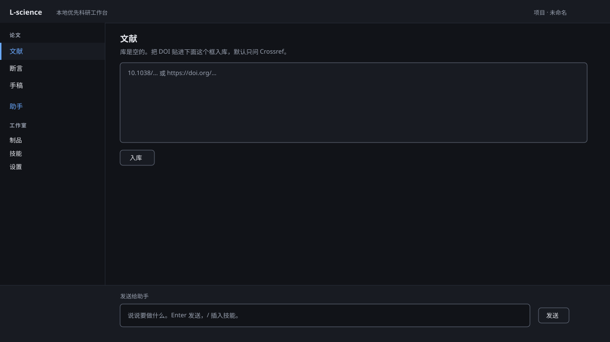
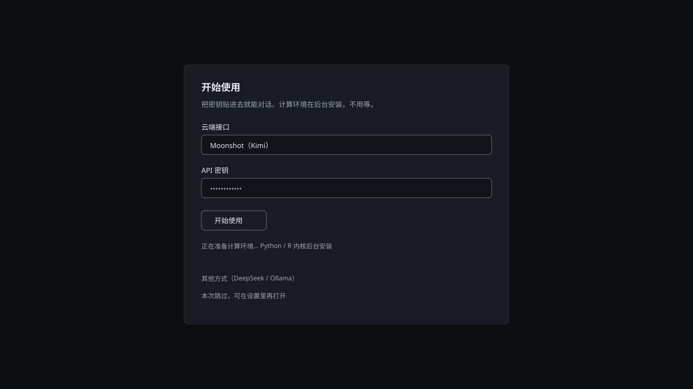
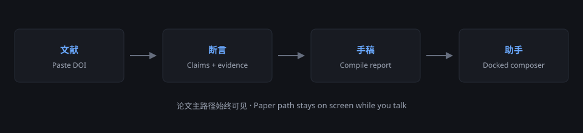

# L-science

[中文](README.md) · **English**

A local-first AI research workbench for Windows. Literature, claims, manuscripts, and Python/R kernels stay on your machine. No cloud backend.

**1.0.0** · Windows x64 · MIT · [GitHub](https://github.com/LiangyuLu-lly/L-science)

No macOS / Linux builds · no auto-update · unsigned installer

---

## Interface

After launch you land on **Literature**, with one call to action: paste a DOI or drop a PDF. A paywalled or local PDF can be dropped onto an entry to attach the full text.



First launch asks for an API key (Kimi / Qwen / OpenAI / Groq). Skipping does not block Literature, Claims, or Manuscripts. With no enabled model, the composer cannot send; it shows "没有可用模型" and **去登记模型**. Kernel setup is a one-click action, not a silent install.





---

## What it is

The paper path is the product, not another chat window:

1. **Literature**: paste a DOI or drop a PDF. The resolver talks to Crossref, OpenAlex, Semantic Scholar, PubMed, Europe PMC, and DataCite. Entries can fetch full text, delete, scan duplicates / merge, and export.
2. **Claims**: unsupported and open items sort first. Rows can confirm / verify / close / reopen / unbind evidence / delete. Extract uses attached full text when present (stamped extracted from the full text); otherwise title+abstract, stamped 摘自题录与摘要（无全文） or 摘自题录与摘要（扫描件无文本层）.
3. **Manuscripts**: compile produces Markdown and a check report. View in Artifacts. Journal profiles are selectable. Unresolved claims block “ready to submit”.
4. **Studio**: artifacts, skills, connectors, routing, usage, tools, settings.

The composer stays visible on paper views; 助手 expands the transcript. Model quality is the key you register. No enabled model, no intelligence.

---

## Can / cannot

**Can**

- Register several cloud gateways. First-run presets are Kimi, Qwen, OpenAI, Groq; OpenRouter and others live in Settings
- Local Ollama
- One-click micromamba + `lsci` / `lsci-r` (not bundled; conda commands are the fallback)
- Extract text from PDFs that have a text layer; scanned PDFs have none
- Export a reproducibility zip and reveal it in Explorer
- Keys in DPAPI only; no telemetry
- Settings **Grants** lists host paths and domains, with revoke
- A red-light skill cannot be picked, its SKILL.md is not injected, and the model is told it cannot run here

**Will not (on purpose)**

- Sign you up for a cloud account
- Ship conda / ColabFold / CUDA inside the NSIS package
- Inject red-light skill procedures as if they ran
- Silent auto-update, code signing, macOS / Linux
- Compile a journal PDF or Word file

---

## Install

1. Run `npm run pack:win`. The installer `L-science-Setup-1.0.0.exe` lands in `release/win/`. There is no prebuilt download.
2. SmartScreen “Windows protected your PC” → **More info → Run anyway**. Unsigned publisher is expected.
3. Per-user install; no administrator required.

Data lives in `%LOCALAPPDATA%\L-science`. Uninstall does **not** delete it. Multiple instances: set `L_SCIENCE_DATA_DIR`.

---

## First launch

1. Default provider is **Kimi**; switch to Qwen / OpenAI / Groq if you want. OpenRouter / SiliconFlow / Together are Settings-only, not first-run presets.
2. Paste the API key into the password field, click **Start**. The key is wiped from the form immediately.
3. Click **一键安装 Python / R 内核**: existing conda if present, otherwise micromamba under the data dir. The installer does not bundle conda.
4. Running Ollama is detected automatically.
5. Literature needs approval to reach metadata hosts; revoke those Grants in Settings.

DeepSeek and manual conda commands live under “other / manual”. Skip opens Settings, and does not lock Literature / Claims / Manuscripts.

Fallback if one-click fails:

```text
conda create -n lsci python=3.13 ipykernel -y
conda create -n lsci-r -c conda-forge r-base r-irkernel -y
```

Or `scripts/bootstrap-kernels.ps1`.

---

## Daily use

1. **Literature**: paste a DOI or drop a PDF. Failures show each upstream reason. Drop a paywalled PDF onto an entry to attach full text.
2. Write from the paper-view composer. With no enabled model it will not send; go register a model.
3. **Claims**: handle unsupported and open items first. Extract stamps the source.
4. **Manuscripts**: Compile produces Markdown and a check report. View in Artifacts. Journal profile limits are approximations of author guidelines and go stale; check the journal before cutting text. Compile history is listed. Unresolved claims block “ready to submit”.
5. **Artifacts**: exporting a zip reveals the folder.
6. Settings Grants can revoke host paths and domains.

Sidebar:

```text
Paper path
  Literature   (home)
  Claims
  Manuscripts
Assistant     transcript toggle (composer stays on paper views)
Studio
  Artifacts / Skills / Connectors / Routing / Usage / Tools / Settings
```

---

## Privacy

- No telemetry
- Keys encrypted with Windows DPAPI, local only
- Uninstalling the setup does not wipe the data directory

---

## Development

Requires Node ≥ 24.

```powershell
npm install
npm run doctor
npm run dev:ui
npm run dev:shell
```

UI: `http://127.0.0.1:5223`. After control-plane changes, restart Electron; Vite can stay up.

```powershell
npm run pack:win
```

Output: `release/win/`. `vendor/` and `release/` are not committed.

---

## License

[MIT](LICENSE) © 2026 LiangyuLu-lly
